<div align="center">

# 🦷 ClinLeen — كلين لين

**Multi-tenant SaaS platform for dental clinics: patients, appointments, dental charts, billing, inventory, and labs, in Arabic and English.**

[](https://mustafacoder365.github.io/clinleen-showcase/)


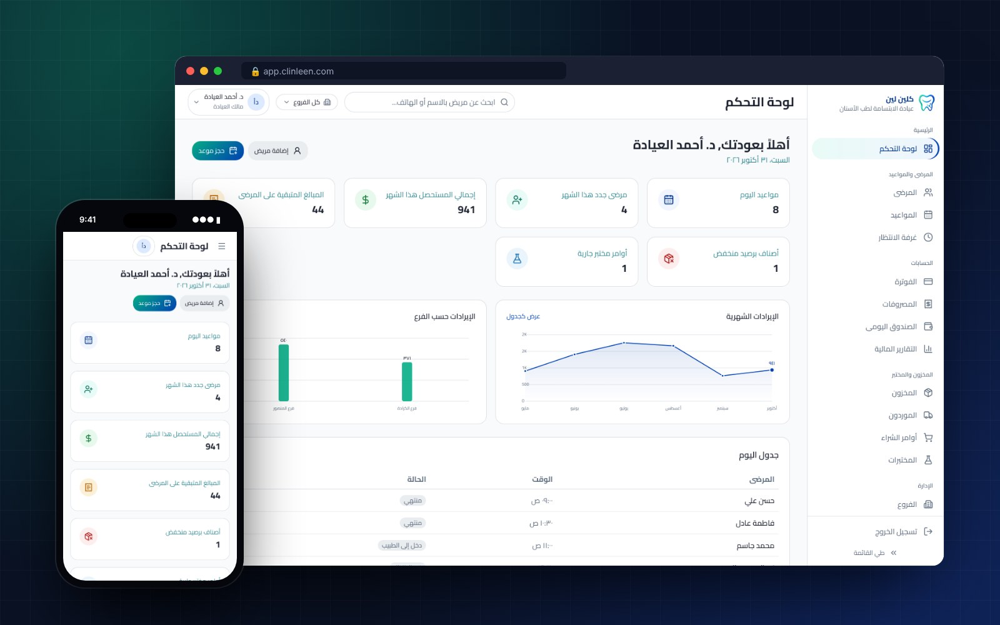

</div>

> 🔒 **This repository is a showcase.** ClinLeen is a commercial product, so its source code is private. Screens below come from the real app running with demo data.

---

## ✨ What it does

ClinLeen lets any dental clinic subscribe and run its whole practice from one account, fully isolated from every other clinic on the platform.

| | |
|---|---|
| 🏥 **Multi-tenant, multi-branch** | Each clinic is a tenant with strict data isolation; one clinic can run several branches with their own staff, chairs, and schedules |
| 👥 **Roles and permissions** | Platform admin, clinic owner, dentist, and reception, with a granular permission catalog and an audit log |
| 🦷 **Interactive dental chart** | FDI numbering for permanent and primary teeth, per-surface conditions, and a full treatment history for every tooth |
| 📅 **Appointments** | Booking from the dashboard or a public booking page, status flow (pending → confirmed → arrived → with doctor → completed), and conflict prevention per dentist and chair |
| ⏱️ **Waiting room** | Live queue with check-in, call-in, and waiting time |
| 📋 **Complete patient file** | Medical history, visits, treatment plans, prescriptions, consents, cosmetic and laser sessions, lab orders, photos, and billing |
| 💳 **Billing** | Itemized invoices, discounts, installment plans, partial payments, local methods (Cash, Card, ZainCash, Qi Card, FastPay), and voids with reasons |
| 💰 **Cash and expenses** | Daily cash register sessions per branch, expenses by category, and financial reports with CSV export |
| 📦 **Inventory and labs** | Stock with batches and expiry, low-stock and expiry alerts, suppliers, purchase orders, and dental lab orders with delivery tracking |
| 🔔 **Notifications** | Appointment reminders through a provider interface, ready for email, WhatsApp, or SMS |
| 🌍 **Arabic and English** | Full right-to-left and left-to-right layouts, chosen before sign-in |
| 📱 **Installable** | Mobile-first UI that installs as a PWA |

---

## 🖼️ Screens

### Interactive dental chart
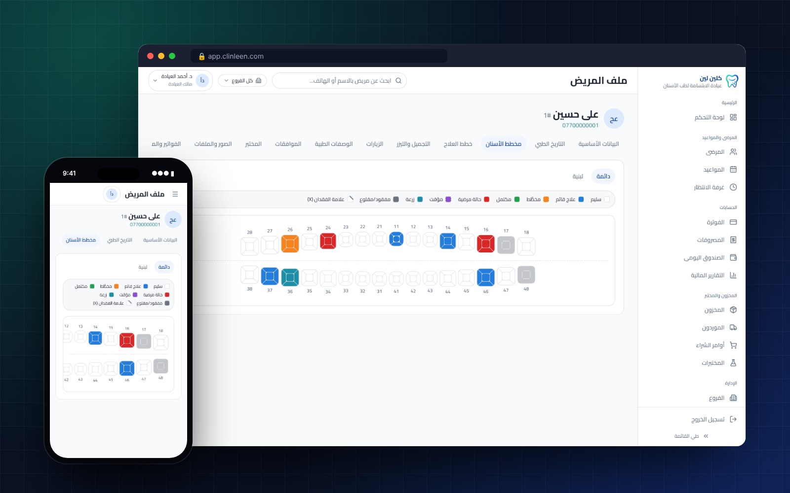

### Appointments and waiting room
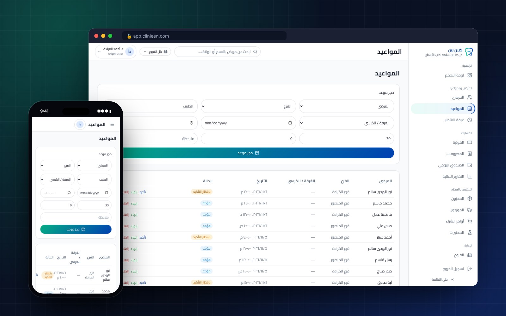
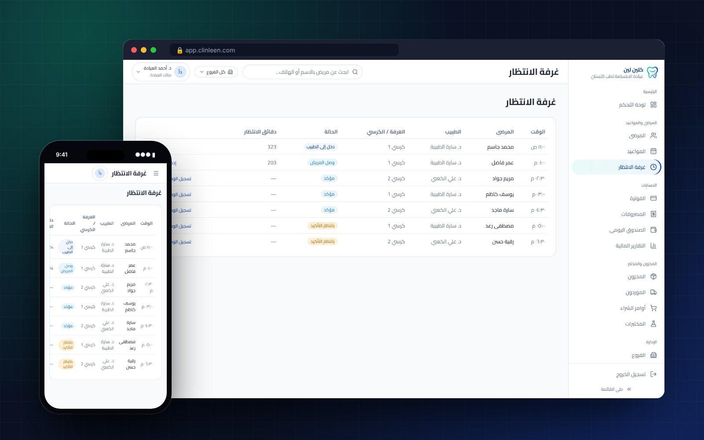

### Public booking page for patients
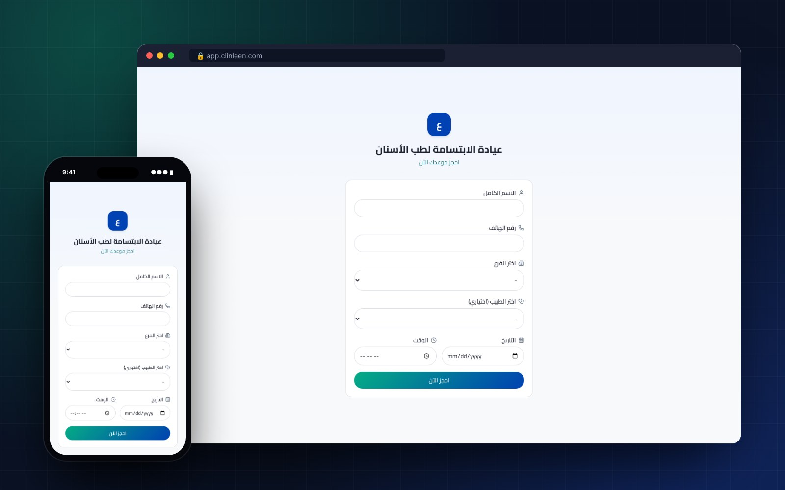

### English interface
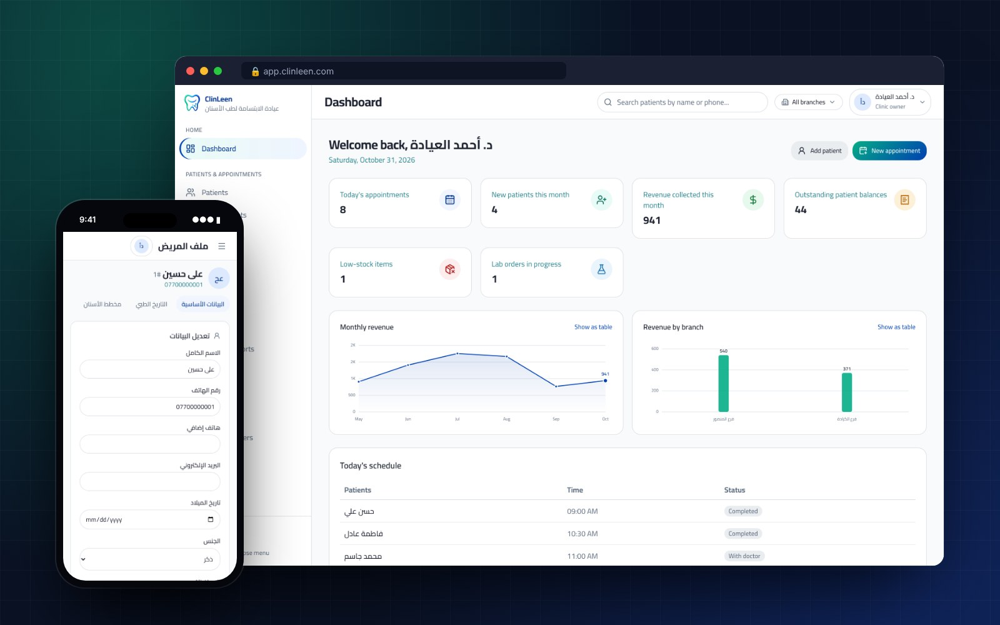

<details>
<summary><b>More screens</b></summary>
<br>

| | |
|---|---|
| 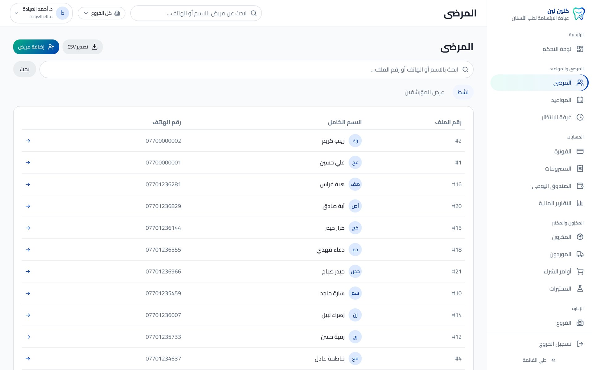 Patients | 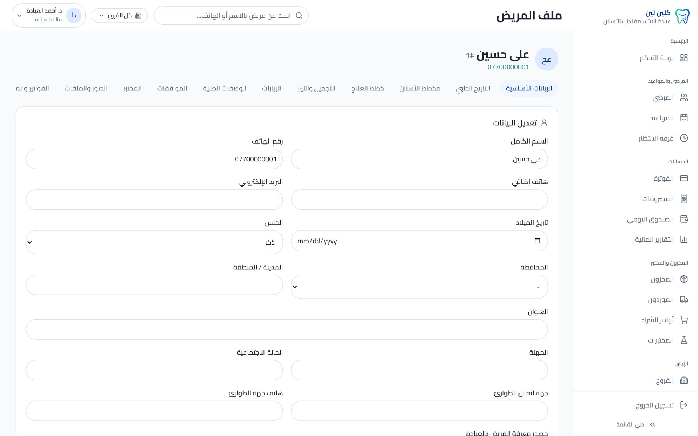 Patient file |
| 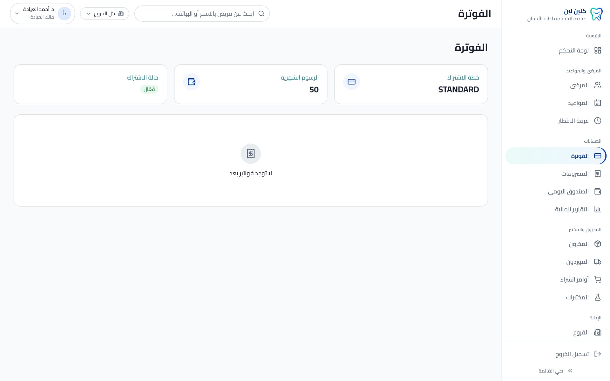 Billing | 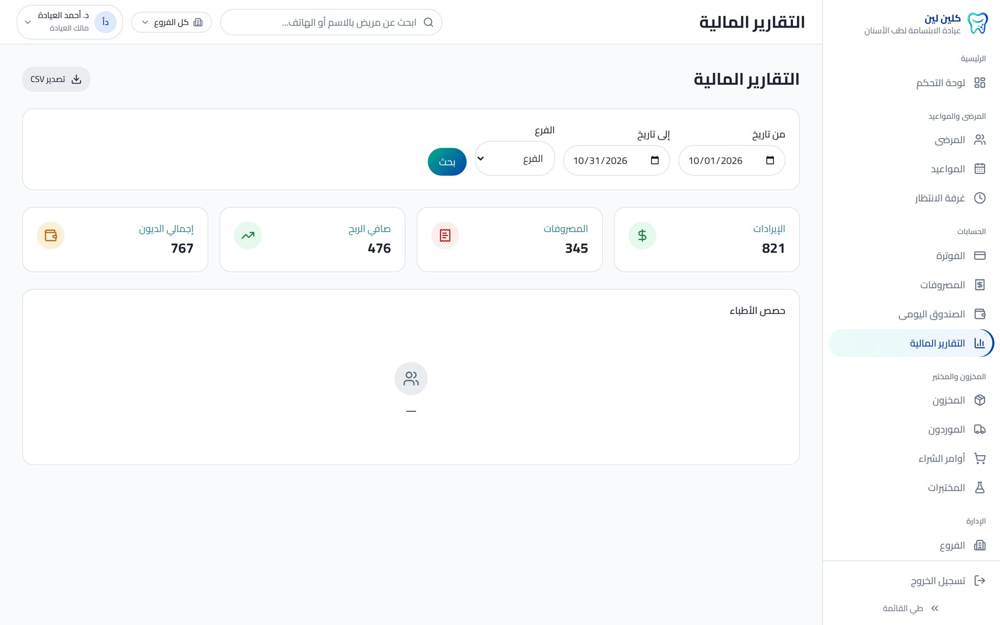 Financial reports |
| 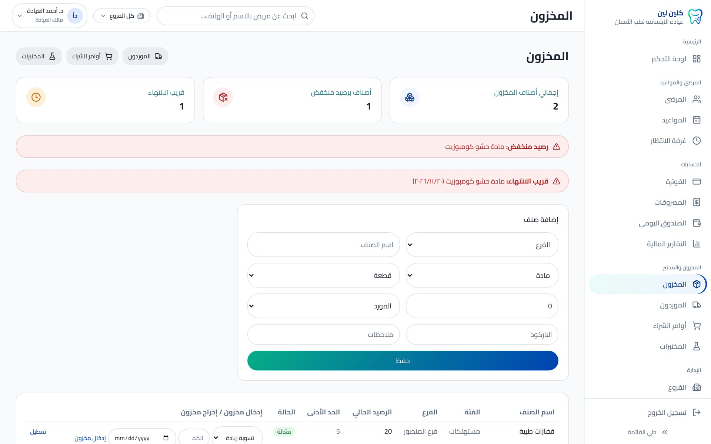 Inventory | 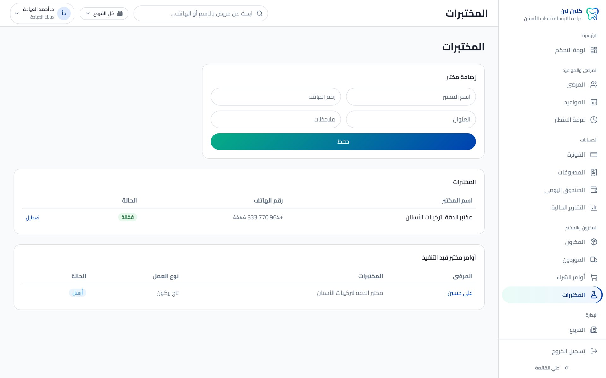 Labs |
| 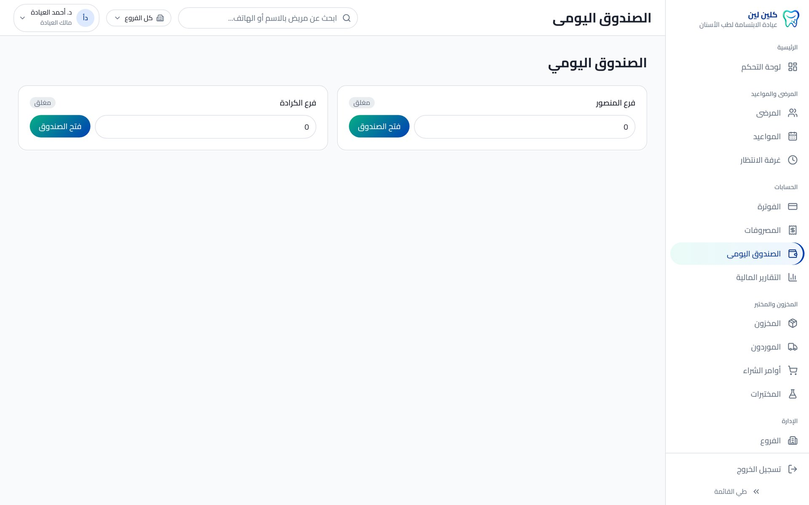 Daily cash register | 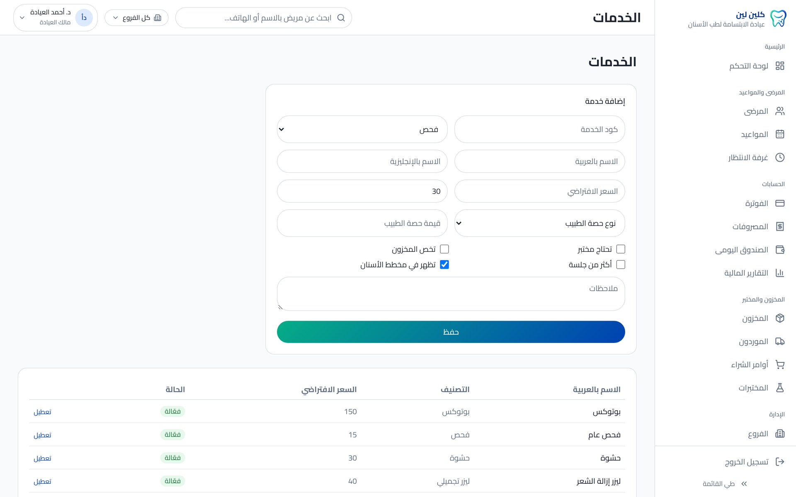 Services and pricing |
| 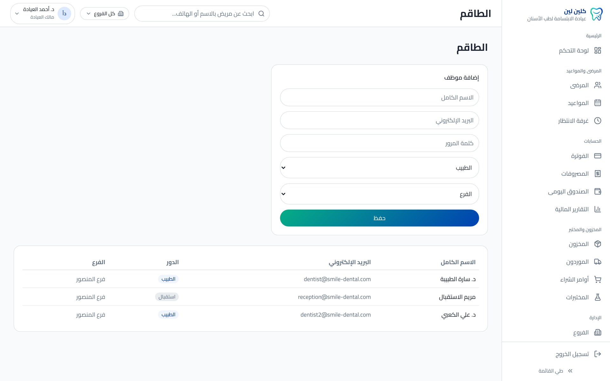 Staff | 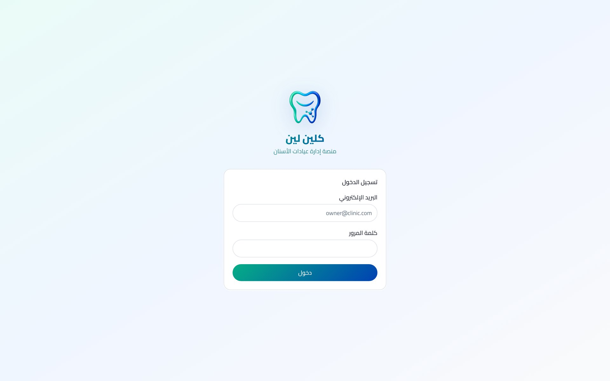 Sign in |

</details>

---

## 🏗️ Architecture

```
Next.js 14 (App Router, Server Actions)
├── NextAuth (credentials, role-based sessions)
├── Middleware: locale routing + auth guard
├── Server actions validated with Zod
│     └── every query scoped by clinicId (tenant isolation)
├── Prisma ORM ──► PostgreSQL (47 models, 7 migration phases)
└── PWA: manifest + service worker
```

**Built in phases:** permissions, branches, and audit → medical history, visits, and media → services, treatment plans, prescriptions, and consents → appointment states and conflict prevention → invoicing, installments, expenses, and cash → inventory and labs → notifications.

---

## 👤 Author

**Mustafa Shakir** — Frontend Software Developer, Baghdad

[](https://github.com/MustafaCoder365)
[](https://www.linkedin.com/in/mustafa-shakir-840374330)
[](mailto:mustafa1997670@gmail.com)

Interested in ClinLeen for your clinic, or in a demo? Get in touch.
